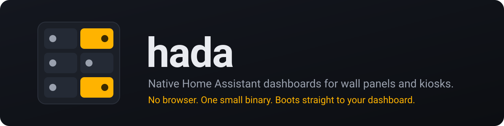
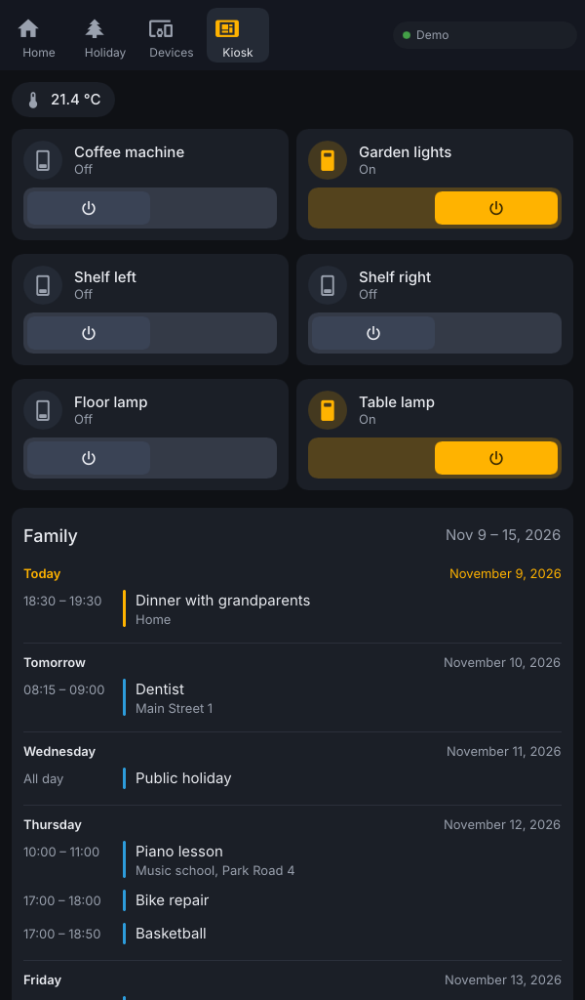
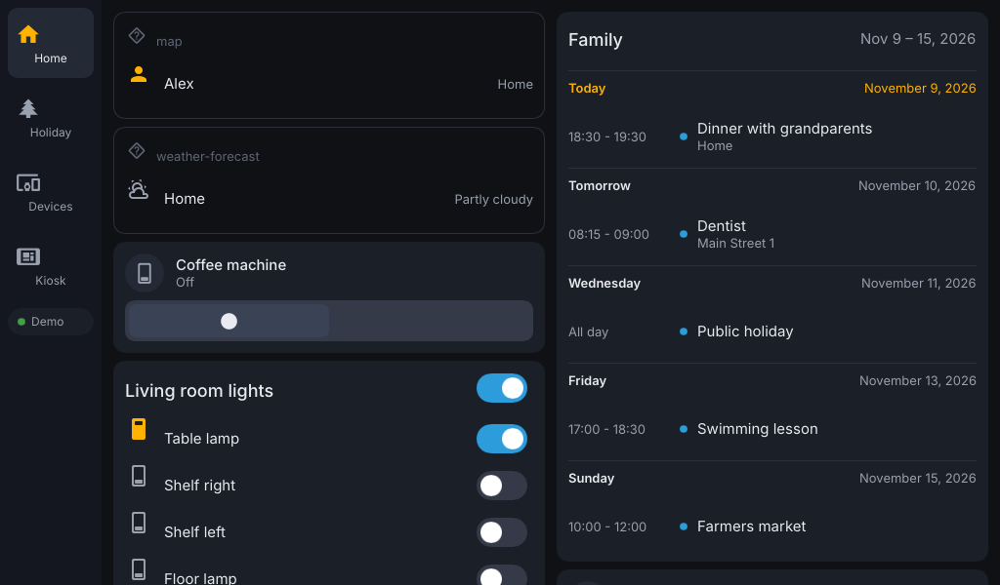

<p align="center"></p>

**hada** shows your Home Assistant dashboard as a native app: no browser, no JavaScript, one binary that draws straight to the screen. It reads the dashboard you already have and is made for wall panels and kiosks, such as a Raspberry Pi with a touchscreen or an old Android tablet.

**Is your browser kiosk slow or sluggish?** Try hada on the same hardware and tell us how it compares: [open an issue](https://github.com/baol/hada-kiosk/issues).

| Portrait | Landscape |
|---|---|
|  |  |

Tiles, entities, glance, sensor, gauge, grid, markdown, button, calendar and weather forecast cards, masonry and sections views, and badges are drawn natively. Other cards appear as placeholders listing their entities' state.

## 1. Get a token

In Home Assistant, open your profile > *Security* > *Long-lived access tokens* > *Create token*. Save it in a file called `ha-token`, holding only the token on one line.

## 2a. Try it in a window

On a Linux desktop: 64-bit Debian 12, Raspberry Pi OS Bookworm, Ubuntu 24.04 or newer.

```bash
curl -fsSLO https://github.com/baol/hada-kiosk/releases/latest/download/hada-$(dpkg --print-architecture).deb && sudo apt install ./hada-$(dpkg --print-architecture).deb
```

```bash
hada --url http://homeassistant.local:8123 --token-file ha-token
```

Other distributions with glibc 2.36+, libinput, libseat, libudev, libxkbcommon and fontconfig (plus the X11 or Wayland client libraries of any desktop) can use the plain binary:

```bash
curl -fsSL -o hada https://github.com/baol/hada-kiosk/releases/latest/download/hada-$(uname -m)-linux-gnu && chmod +x hada && ./hada --url http://homeassistant.local:8123 --token-file ha-token
```

## 2b. Install in kiosk mode

> [!WARNING]
> **Kiosk mode** turns the device into a single-purpose screen. It boots straight into hada, full screen, **instead of the desktop**: the display manager is disabled and the desktop no longer starts. SSH keeps working, and [uninstall](#undo-kiosk-mode) brings the previous setup back.

On the device, in the folder with `ha-token`:

```bash
curl -fsSL https://github.com/baol/hada-kiosk/releases/latest/download/install-kiosk.sh | HA_URL=http://homeassistant.local:8123 bash
```

Portrait screen, opening the `kiosk` view of the default dashboard:

```bash
curl -fsSL https://github.com/baol/hada-kiosk/releases/latest/download/install-kiosk.sh | HA_URL=http://homeassistant.local:8123/lovelace/kiosk ROTATION=90 bash
```

Then reboot. The log is in `journalctl -u hada -b`. Running the installer again with other settings is safe.

| Setting | Default | |
|---|---|---|
| `HA_URL` | required | Home Assistant as seen from the device; a dashboard URL also picks dashboard and view. |
| `TOKEN_FILE` | `ha-token` | Token file. `""` logs in through [trusted networks](https://www.home-assistant.io/docs/authentication/providers/#trusted-networks) instead. |
| `ROTATION` | `0` | `0`/`180` landscape, `90`/`270` portrait. |
| `TOUCH_ROTATION` | `ROTATION` | Change it if touches land in the wrong place. |
| `LANG_CODE` | `$LANG` | Language for state texts: `en`, `it`, `de`, … |
| `HA_USER` | | Trusted networks user, if several are allowed. |
| `HADA_VERSION` | `latest` | Release to install, such as `v0.1.0`. |

### Undo kiosk mode

```bash
curl -fsSL https://github.com/baol/hada-kiosk/releases/latest/download/install-kiosk.sh | bash -s uninstall
```

This restores the boot target, display manager, seatd and groups recorded at install, and removes hada. Reboot to finish.

## 2c. Android phone or tablet

For Android 5.0 or newer, including old Amazon Fire tablets. On the device, download [`hada.apk`](https://github.com/baol/hada-kiosk/releases/latest/download/hada.apk), open it and allow the install (on a Fire: Settings > Security & Privacy > *Apps from Unknown Sources*).

On first start, enter the Home Assistant address, then a username and password (used once; only a sign-in token is kept), or no password for trusted networks, or a long-lived token. Rotation is set there too. Tap the status chip on the dashboard to change these later.

For a wall panel, press Home and choose hada, *Always*: the device starts straight into the dashboard and the screen stays on. To undo, pick another Home app in Android settings > Apps > Default apps. Where the Home app cannot be changed (Fire tablets), keep *Start when the device starts* on.

## Options

Flags, environment variables, or keys in `~/.config/hada/config.toml` ([example](deploy/config.example.toml)).

| Flag | Environment | |
|---|---|---|
| `--url` | `HADA_URL` | Home Assistant URL, optionally with dashboard and view. Default `http://localhost:8123`. |
| `--token`, `--token-file` | `HADA_TOKEN`, `HADA_TOKEN_FILE` | Long-lived access token. Without one: trusted networks login. |
| `--user` | `HADA_USER` | Trusted networks user. |
| `--lang` | `HADA_LANG` | Language for state texts. Default from `$LANG`. |
| `--dashboard` | `HADA_DASHBOARD` | Dashboard `url_path`, or a local `.yaml` file. |
| `--view` | `HADA_VIEW` | View to open: path, title or index. |
| `--fullscreen` | `HADA_FULLSCREEN` | Full screen window. |
| `--scale` | | UI scale factor. |

## Build from source

With [Rust](https://rustup.rs) on Debian or Ubuntu:

```bash
sudo apt install libfontconfig-dev libinput-dev libudev-dev libxkbcommon-dev libseat-dev libwayland-dev libxkbcommon-x11-dev libx11-xcb-dev libxcursor-dev libxi-dev
```

```bash
cargo run --release -- --url http://homeassistant.local:8123 --token-file ha-token
```

`cargo test --workspace --features screenshot` runs the tests; `scripts/screenshots.sh` renders the demo dashboard without a display; `scripts/build-apk.sh` builds the Android app (needs the Android SDK and a JDK 17+, no Gradle). Issues and pull requests are welcome.

## License

GPL-3.0-only. hada uses the [Slint](https://slint.dev) toolkit under its GPL-3.0 licence; see [LICENSE-NOTICES.md](LICENSE-NOTICES.md).
